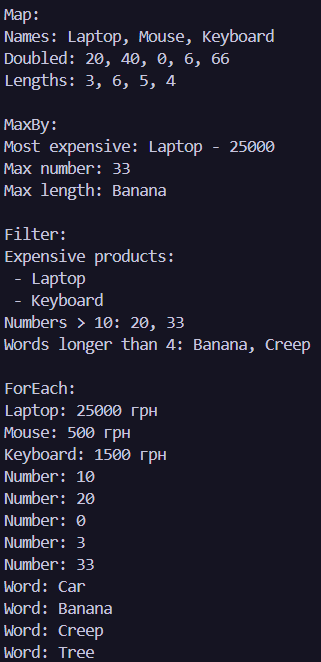

# Самостійна робота №10

# Тема: Делегати й лямбда-вирази: власні утиліти для колекцій.

### Робота: Токарчука Любомира

### Результат в консолі:

### 

### Звіт:

**1. Чому делегати корисні для створення таких утиліт?**
Делегати дозволяють передавати методи як параметри. Завдяки цьому можна створювати універсальні методи, які працюють із різними типами даних і виконують різні дії залежно від переданої функції.

**2. Як лямбда-вирази спрощують виклик цих методів?**
Лямбда-вирази дозволяють коротко записувати дії без створення окремих методів. Наприклад, `n => n * 2` множить число на два. Це робить код простішим і зрозумілішим.

**3. Порівняйте ваші методи з вбудованими LINQ-операторами.**
Мої методи `Map` і `Filter` працюють подібно до LINQ-операторів `Select` і `Where`. Метод `MaxBy` виконує аналогічну функцію до однойменного LINQ-методу. `ForEach` не має прямого стандартного аналога в LINQ для `IEnumerable`. Власні методи дають змогу краще зрозуміти принцип роботи делегатів, узагальнень і лямбда-виразів, хоча LINQ зазвичай зручніший для повсякденного використання.

### Висновок:

Під час роботи я згадав використовувати делегати та лямбда-вирази для створення універсальних методів роботи з колекціями. Реалізував і перевірив методи Map, MaxBy, Filter та ForEach на різних типах даних.
