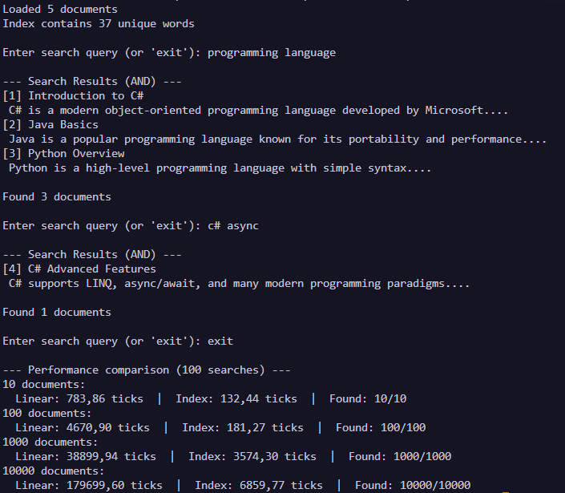

# Самостійна робота №11

## Тема Колекції в практиці ООП: інвертований індекс і вимірювання продуктивності.

## Виконав: Токарчук Любомир.

## Опис проєкту

Консольна програма реалізує повнотекстовий пошук за допомогою інвертованого індексу:

- документ зберігається у словнику `Dictionary<int, Document>`;
- слово пов'язується з множиною ID документів у `Dictionary<string, HashSet<int>>`;
- пошук одного слова перевіряє відповідну множину документів;
- пошук за кількома словами використовує `HashSet.IntersectWith` для операції AND;
- пошук із будь-яким зі слів використовує `HashSet.UnionWith` для операції OR;
- текст автоматично переводиться у нижній регістр, очищується від пунктуації та розбивається на слова.

### Результат в консолі:

### Докладні числові результати вимірювань наведено у файлі [REPORT.md](REPORT.md).

## Висновок

Інвертований індекс дозволяє виконувати пошук значно швидше за лінійний перебір, оскільки пошук починається зі словника за ключовим словом, а не з послідовного перегляду всіх документів. Найбільша перевага проявляється на великій кількості документів.
