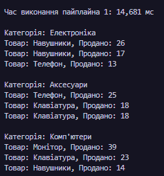
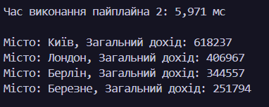
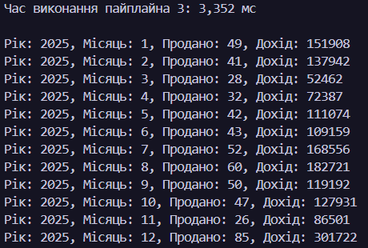
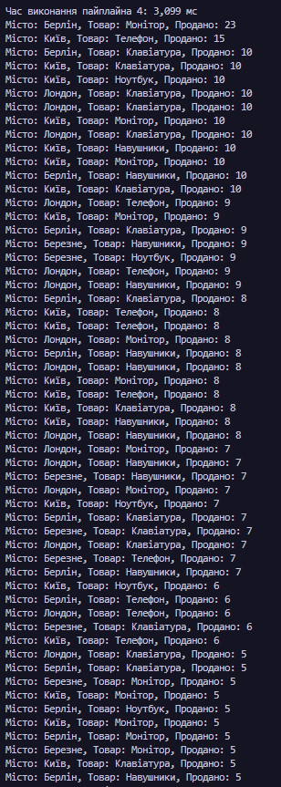

### Самостійна робота №12

### **Тема:** LINQ pipelines: ETL та аналітика

### **Робота:** Токарчука Любомира

## Опис реалізованих пайплайнів

### Пайплайн 1.

#### Мета: визначити три найпопулярніші товари в кожній категорії.

Використані оператори:

- `GroupBy` - групування продажів за товарами та категоріями.
- `Sum` - підрахунок загальної кількості проданих одиниць.
- `Join` - об'єднання продажів з інформацією про товари.
- `Select` - формування результатів.
- `OrderByDescending` - сортування за кількістю продажів.
- `Take(3)` - вибір трьох найпопулярніших товарів.

### Пайплайн 2. Загальний дохід за містами клієнтів

#### Мета: визначити загальний дохід від продажів у кожному місті.

Використані оператори:

- `Join` - об'єднання продажів із товарами та клієнтами.
- `Select` - обчислення доходу за формулою Quantity \* UnitPrice.
- `GroupBy` - групування продажів за містами.
- `Sum` - підрахунок загального доходу.
- `OrderByDescending` - сортування міст за доходом.

### Пайплайн 3. Продажі за місяцями та роками

#### Мета: проаналізувати кількість проданих товарів і дохід за кожен місяць.

Використані оператори:

- `Join` - отримання ціни товару.
- `GroupBy` - групування продажів за роком і місяцем.
- `Select` - формування статистики.
- `Sum` - підрахунок кількості та доходу.
- `OrderBy` і `ThenBy` - сортування за роком і місяцем.

### Пайплайн 4. Популярність товарів за містами

#### Мета: визначити кількість проданих одиниць кожного товару в різних містах, враховуючи лише продажі від 5 одиниць.

Використані оператори:

- `Where` - фільтрація продажів.
- `Join` - об'єднання продажів із товарами та клієнтами.
- `GroupBy` - групування за містом та ідентифікатором товару.
- `Select` - формування результатів.
- `Sum` - підрахунок кількості проданих одиниць.
- `OrderByDescending` - сортування за популярністю.

## Результати вимірювання продуктивності

Для вимірювання часу виконання кожного пайплайна використовувався окремий об'єкт `Stopwatch`.

| Пайплайн   | Час виконання |
| ---------- | ------------: |
| Пайплайн 1 |     14,681 мс |
| Пайплайн 2 |      5,971 мс |
| Пайплайн 3 |      3,352 мс |
| Пайплайн 4 |      3,099 мс |

### Аналіз продуктивності

Найбільший час виконання показав перший пайплайн - 14,681 мс. Це пов'язано з кількома операціями групування, сортування та вибору найпопулярніших товарів. Другий пайплайн виконався за 5,971 мс, оскільки потребував об'єднання трьох колекцій і підрахунку доходу. Третій пайплайн виконався за 3,352 мс, а четвертий - за 3,099 мс. Вони показали найменший час виконання в цьому запуску.
На продуктивність можуть впливати обсяг даних, кількість операцій LINQ, складність групування та сортування, а також навантаження комп'ютера.

## Висновок

Під час виконання самостійної роботи я навчився використовувати LINQ для фільтрації, об’єднання, групування, сортування та аналізу даних. Реалізував чотири окремі LINQ-пайплайни та навчився вимірювати час їх виконання за допомогою Stopwatch. Також я навчився розділяти проєкт на різні файли, створювати окремі класи та організовувати код для зручнішої роботи. Отримані знання допомогли краще зрозуміти можливості LINQ і принципи структурованої розробки програм.

## Результати в консолі:

### 

### 

### 

### 
