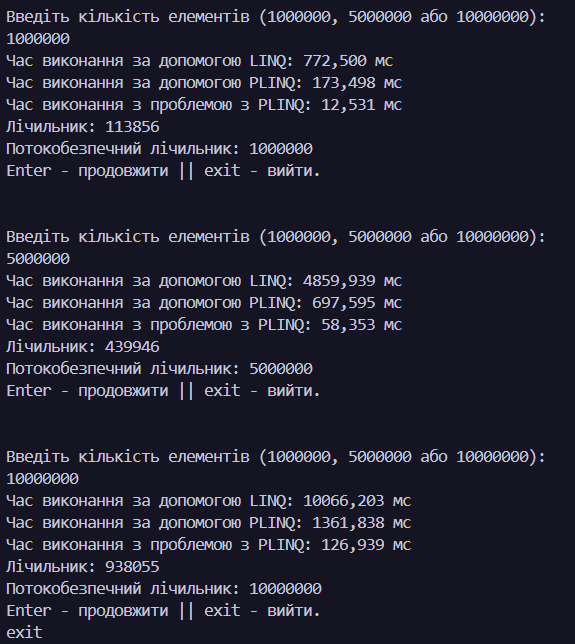

# Самостійна робота №13

## Тема: PLINQ: дослідження продуктивності та безпеки.

### Робота: Токарчука Любомира

### Висновок

У ході виконання самостійної роботи було досліджено особливості паралельної обробки даних за допомогою PLINQ та порівняно її продуктивність зі звичайним LINQ. Проведені експерименти показали, що PLINQ забезпечує значне прискорення обчислень під час роботи з великими обсягами даних. Також було розглянуто проблему, яка виникає внаслідок одночасного доступу кількох потоків до спільної змінної, та продемонстровано її вирішення за допомогою Interlocked.Increment(). У результаті роботи було закріплено практичні навички використання паралельних запитів, вимірювання їхньої продуктивності та забезпечення потокобезпеки. Отже, використання PLINQ може суттєво підвищити ефективність обробки даних, проте потребує правильного застосування та врахування особливостей багатопотокового виконання.

### Результат в консолі:

### 

### Проведення та аналіз експериментів

Для дослідження продуктивності LINQ та PLINQ було створено колекції випадкових цілих чисел розміром 1 000 000, 5 000 000 та 10 000 000 елементів. Як обчислювальну операцію використано перевірку чисел на простоту за допомогою методу `IsPrime()`, після чого знайдені прості числа множилися на 2. Час виконання кожного запиту вимірювався за допомогою класу `Stopwatch`.

Під час обробки 1 000 000 елементів LINQ виконав операцію за 772,500 мс, а PLINQ - за 173,498 мс. Для 5 000 000 елементів результати становили 4859,939 мс і 697,595 мс відповідно. Під час обробки 10 000 000 елементів LINQ витратив 10066,203 мс, тоді як PLINQ — 1361,838 мс.

Отримані результати показали, що в усіх проведених експериментах PLINQ працював швидше за звичайний LINQ. Це пояснюється розподілом обчислень між кількома потоками процесора, що дає змогу виконувати операції паралельно. Водночас на невеликих обсягах даних або під час виконання простих операцій PLINQ може виявитися повільнішим через додаткові витрати на організацію паралельного виконання.

Окремо було досліджено проблему потокобезпеки під час паралельної обробки. Для цього використовувалася спільна змінна `counter`, яка збільшувалася за допомогою `counter++` усередині паралельного циклу `ForAll()`. Через одночасне звернення кількох потоків до цієї змінної виникла проблема Race Condition, унаслідок якої частина операцій збільшення втрачалася. Для усунення проблеми було використано `Interlocked.Increment()`, який забезпечує атомарне збільшення значення. У результаті потокобезпечний лічильник правильно відобразив кількість усіх оброблених елементів.
