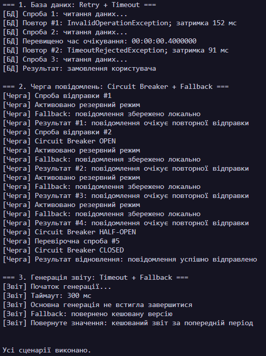

# Самостійна робота №14

## Тема: Кейси Polly/Retry: короткий звіт

**Виконав:** Токарчук Любомир

## Опис реалізованих сценаріїв

У межах роботи було розроблено три практичні сценарії, які імітують типові проблеми під час взаємодії програмного забезпечення із зовнішніми сервісами. Для їх реалізації використано бібліотеку Polly та сучасний підхід `ResiliencePipelineBuilder`.

### Сценарій 1. Робота з базою даних: Retry + Timeout

- **Проблема:** під час звернення до бази даних можуть виникати тимчасові помилки або затримки відповіді, через які операція не завершується вчасно.
- **Обрана стратегія:** `Retry` використовується для автоматичного повторення операції після тимчасової помилки, а `Timeout` обмежує максимальний час виконання одного запиту.
- **Реалізація:** налаштовано максимум три повторні спроби з експоненційним збільшенням затримки та випадковим відхиленням (`UseJitter`). Час очікування однієї операції обмежено 400 мілісекундами. Для перевірки роботи механізмів перша спроба завершується помилкою, друга перевищує встановлений час очікування, а третя виконується успішно.
- **Очікувана поведінка:** після виникнення помилки система автоматично повторює запит. Якщо операція перевищує встановлений час, вона переривається, після чого запускається наступна спроба. У результаті дані успішно отримуються.

### Сценарій 2. Черга повідомлень: Circuit Breaker + Fallback

- **Проблема:** під час перевантаження черги повідомлень або недоступності сервісу повторні запити можуть лише збільшувати навантаження та погіршувати ситуацію.
- **Обрана стратегія:** `Circuit Breaker` тимчасово припиняє виконання запитів після визначеної кількості помилок. `Fallback` забезпечує альтернативний результат, коли основна операція завершується невдало або Circuit Breaker перебуває у відкритому стані.
- **Реалізація:** налаштовано відкриття Circuit Breaker після двох невдалих операцій, тривалість відкритого стану становить одну секунду. Резервна стратегія повертає повідомлення про очікування повторної відправки та імітує його локальне збереження. Після завершення періоду блокування виконується перевірочний запит.
- **Очікувана поведінка:** перші дві спроби завершуються помилкою, після чого Circuit Breaker переходить у стан `OPEN` і блокує наступні запити. Резервний механізм повертає альтернативний результат. Після завершення часу очікування система переходить у стан `HALF-OPEN`. Якщо перевірочний запит успішний, Circuit Breaker повертається до стану `CLOSED`, що означає відновлення роботи сервісу.

### Сценарій 3. Генерація звіту: Timeout + Fallback

- **Проблема:** формування звіту може тривати надто довго, через що користувач не отримує результат вчасно.
- **Обрана стратегія:** `Timeout` обмежує тривалість генерації звіту, а `Fallback` повертає резервний результат у разі перевищення встановленого часу.
- **Реалізація:** час виконання основної операції обмежено 300 мілісекундами. Для імітації затримки генерація триває 700 мілісекунд. Якщо операція не встигає завершитися, замість неї повертається попередньо підготовлена кешована версія звіту.
- **Очікувана поведінка:** після перевищення встановленого часу основна операція переривається, а система автоматично повертає кешований звіт. Таким чином, користувач отримує результат навіть за умови повільної роботи основного механізму.

## 2. Результати виконання

Усі три сценарії було реалізовано в програмі `Program.cs`. Для перевірки роботи стратегій використано імітацію помилок, затримок та відновлення сервісів. У процесі виконання програма виводить інформацію про кожну спробу, повторні запити, тайм-аути, перехід між станами Circuit Breaker та використання резервних механізмів.

### Результат в консолі:

### 

## Висновок

Під час виконання самостійної роботи було досліджено можливості бібліотеки Polly для підвищення надійності програмного забезпечення. Реалізовано три сценарії, у яких використано механізми `Retry`, `Timeout`, `Circuit Breaker` та `Fallback`. У результаті роботи було перевірено, як система реагує на тимчасові помилки, перевищення часу очікування та недоступність зовнішніх сервісів. Також досліджено можливість поєднання декількох стратегій у межах одного конвеєра стійкості (`ResiliencePipeline`). Отже, використання Polly дає змогу зробити програму стійкішою до тимчасових збоїв, уникати зайвого навантаження на недоступні сервіси та забезпечувати альтернативні результати виконання операцій.
