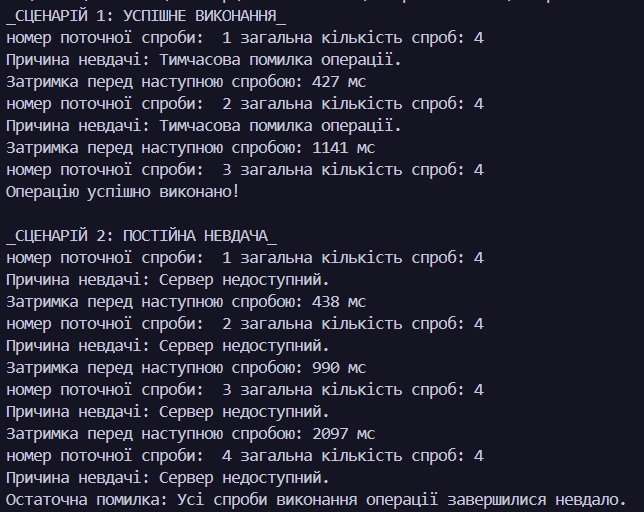

# Самостійна робота №15

### **Тема:** Реалізація exponential backoff.

### **Робота:** Токарчука Любомира

## Хід роботи

Створено консольний проєкт `IndependentWork14` мовою програмування C#. У межах роботи реалізовано клас `RetryPolicy`, який забезпечує повторне виконання операцій у разі виникнення помилок. Клас містить приватні поля для зберігання максимальної кількості повторних спроб, початкової затримки та коефіцієнта випадкового відхилення. Для виконання операцій використовується узагальнений метод `Execute<T>`, який приймає делегат `Func<T>`, а також необов'язковий делегат `shouldRetry` для визначення можливості повторного виконання операції. Для розрахунку затримки реалізовано формулу експоненційного backoff із випадковим jitter:

```csharp
delay = initialDelay * Math.Pow(2, retryAttempt) * (1 + random.NextDouble() * jitterFactor * 2 - jitterFactor);
```

Між повторними спробами використовується `Thread.Sleep`. Також реалізовано виведення в консоль номера спроби, причини невдачі та тривалості затримки.

### Результат в консолі:

### 

### Висновок:

Під час виконання роботи я навчився реалізовувати механізм повторних спроб із використанням експоненційної затримки та випадкового jitter. На практиці переконався, що цей підхід допомагає краще обробляти тимчасові помилки та уникати надмірного навантаження на систему. Також зрозумів, що повторювати варто не кожну операцію, а лише ті, для яких це безпечно та доцільно. Отримані знання допоможуть мені створювати надійніші програми.
