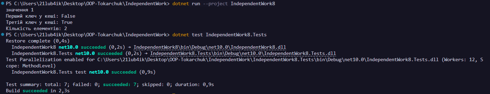

# Самостійна робота №8

### **Тема:** Узагальнений кеш Cache &lt;TKey, TValue> із тестами.

# **Хід роботи:**

Створено консольний проєкт IndependentWork8 та окремий тестовий проєкт IndependentWork8.Tests. Реалізовано узагальнений клас Cache&lt;TKey, TValue> із використанням Dictionary&lt;TKey, TValue> та Queue&lt;TKey>. Додано обмеження ємності кешу та політику FIFO для видалення найстаріших елементів. Реалізовано методи Add(), Get(), ContainsKey() і властивість Count. Також створено юніт-тести для перевірки основних функцій кешу та продемонстровано його роботу в методі Main().

# **Результат:**

### 
