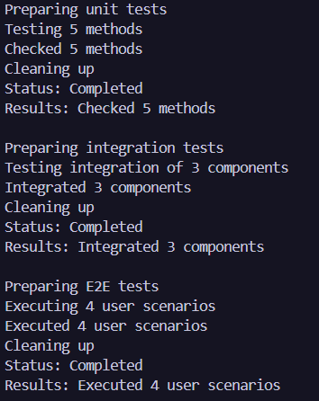

# Лабораторна робота №11
### __Тема:__ DocumentProcessor: шаблонні кроки й реалізації.

### 6. TestRunner (Запуск тестів)
* __Шаблонний метод:__ Run() → SetUp, ExecuteTests, CollectResults, TearDown, Gener-ateReport.
* __Похідні:__ UnitTestRunner, IntegrationTestRunner, E2ETestRunner.

# __Хід роботи:__
Було реалізовано абстрактний клас TestRunner із шаблонним методом Run(), який послідовно виконує п’ять кроків: підготовку, виконання тестів, збір результатів, очищення та формування звіту. Було створено три похідні класи: UnitTestRunner, IntegrationTestRunner і E2ETestRunner, кожен з яких реалізує власну логіку виконання тестів. Для зберігання стану та результатів використано властивості Status і Results. У методі Main() об’єкти різних класів було збережено у списку типу List<TestRunner> та послідовно запущено. Під час виконання програми перевірено роботу всіх трьох реалізацій і виведення звітів у консоль.

# __Результат:__ 
### 