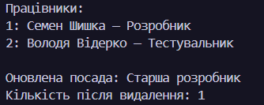
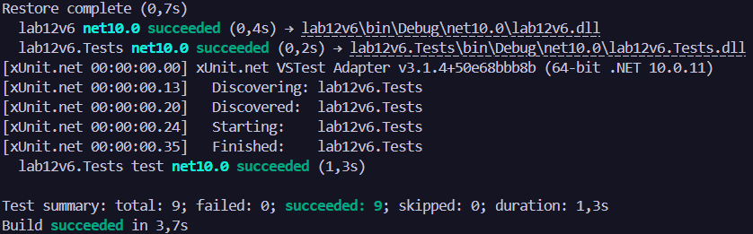

# Лабораторна робота №12
### __Тема:__ Узагальнені типи (Generics). IRepository з where-обмеженнями та тестами.

### Варіант: 6. Сутність Employee: FirstName (string), LastName (string), Position (string).

# __Хід роботи:__

Під час виконання лабораторної роботи було створен інтерфейс IEntity із властивістю Id та клас Employee, який реалізує цей інтерфейс і містить властивості FirstName, LastName та Position. Розробив узагальнений інтерфейс IRepository<T> з обмеженням where T : IEntity і реалізував InMemoryRepository<T> для зберігання працівників у пам’яті та виконання операцій додавання, отримання, оновлення й видалення. Для перевірки роботи репозиторію написано xUnit-тести для CRUD-операцій, зокрема для випадків із неіснуючими записами, і запущено демонстрацію в консольній програмі. Усі 9 тестів пройшли успішно.

# __Результат:__ 
### 
### 