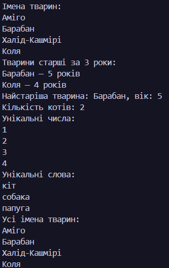

# Лабораторна робота №13

### **Тема:** Generic-методи для повторного використання компонентів: Mapper/MaxBy/Reduce з Func/Action.

### Варіант: 6. Map, Filter, MaxBy, Count, Distinct (проста реалізація)

# **Хід роботи:**

У класі FunctionalUtils реалізовано п’ять узагальнених методів: Map, Filter, MaxBy, Count і Distinct, а також додатковий метод ForEach. Для передачі функцій як параметрів використано делегати Func, Action і Predicate. Створено власний клас Animal із тестовими даними. У методі Main продемонстровано роботу реалізованих методів із типами int, string і власним класом, використовуючи лямбда-вирази. Результати виконання програми виведено в консоль.

# **Результат:**

### 
