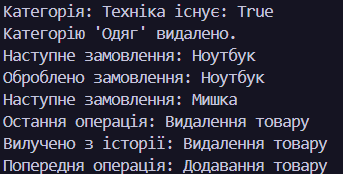

# Лабораторна робота №14

### **Тема:** HashSet/Queue/Stack: практичні сценарії.

### Варіант: 6. Управління інвентарем

- **HashSet:** Унікальні категорії товарів.
- **Queue:** Черга замовлень на поповнення.
- **Stack:** Історія операцій (додавання/видалення товарів).

# **Хід роботи:**

Під час виконання лабораторної роботи було створено консольну програму для управління інвентарем мовою. Для зберігання унікальних категорій товарів використано HashSet<string>, який дозволяє додавати, перевіряти та видаляти категорії без дублювання. Для організації черги замовлень використано Queue<string>, що працює за принципом FIFO - першим обробляється перше додане замовлення. Для збереження історії операцій використано Stack<string>, який працює за принципом LIFO - остання додана операція дістається першою. У програмі реалізовано методи додавання, перевірки, видалення та перегляду елементів, а результати роботи виводяться в консоль. У результаті було закріплено навички використання спеціалізованих колекцій C# та зрозуміло особливості їх застосування на практиці.

# **Результат:**

### 
