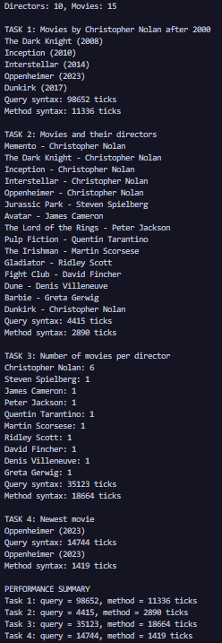

# Лабораторна робота №15

### **Тема:** LINQ в дії: фільтри, join, агрегації. Продуктивність.

### Варіант: 6. Сценарій: Фільмотека.

- **Сутності:** Movie (Id, Title, DirectorId, ReleaseYear), Director (Id, Name, Country).
- **Запити:**

1. Знайти всі фільми режисера “Christopher Nolan”, випущені після 2000 року.
2. Об’єднати фільми з їхніми режисерами, вивести назву фільму та ім’я режисера.
3. Підрахувати кількість фільмів для кожного режисера.
4. Знайти найновіший фільм.

# **Хід роботи:**

У ході лабораторної роботи було створено консольний проєкт на C# та класи `Movie` і `Director` із тестовими даними. За допомогою LINQ реалізовано фільтрацію фільмів Крістофера Нолана після 2000 року, об’єднання фільмів із режисерами, підрахунок фільмів кожного режисера та пошук найновішого фільму. Запити виконано із використанням синтаксису запитів і методів, а час їх виконання виміряно за допомогою `Stopwatch`. Отримані результати використано для порівняння продуктивності LINQ-запитів.

# **Результат:**

### 
