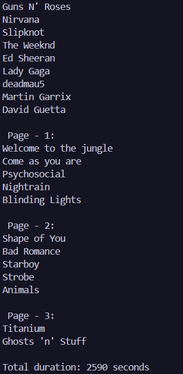

# Лабораторна робота №16

### **Тема:** LINQ: SelectMany, пагінація й custom extensions.

### Варіант: 6. Сценарій: Плейлисти та їхні пісні з виконавцями.

- Сутності: Playlist (Id, Name, List), Song (Id, Title, DurationSeconds, Artist), Artist (Id, Name).
- Запити:

1. SelectMany: Отримати всіх унікальних виконавців з усіх плейлистів.
2. Пагінація: Вивести всі пісні по 5 пісень на сторінку.
3. Custom Extension: Метод розширення TotalDuration() для IEnumerable &lt; Song>, що обчислює загальну тривалість.

# **Хід роботи:**

Створено консольний проєкт lab16v6 та класи Playlist, Song і Artist із вкладеними колекціями. Додано три плейлисти з 12 піснями та відповідними виконавцями. За допомогою SelectMany() отримано список унікальних виконавців із усіх плейлистів. Реалізовано пагінацію пісень по 5 елементів на сторінку за допомогою Skip() і Take(). Створено власний метод розширення TotalDuration() для IEnumerable &lt;Song>, який обчислює загальну тривалість усіх пісень. Результати роботи всіх реалізованих функцій виведено в консоль.

# **Результат:**

### 
