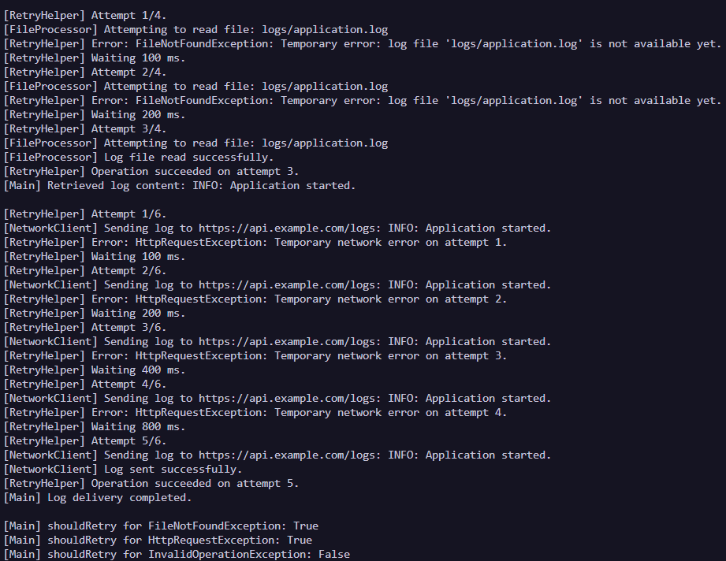

# Лабораторна робота №17

### **Тема:** Обробка IO/мережевих помилок та патерн Retry

### Варіант: 6. Сценарій: Відправка логів.

- FileProcessor: Метод string GetLogContent(string path).
  Імітувати FileNotFoundException перші 2 рази, потім успіх.
- NetworkClient: Метод void SendLogToServer(string url, string logContent).
  Імітувати HttpRequestException перші 4 рази, потім успіх.
- shouldRetry: Повторювати для FileNotFoundException та HttpRequestException.

# **Хід роботи:**

Було реалізовано класи FileProcessor та NetworkClient, які імітують тимчасові помилки під час читання файлу та надсилання журналів на сервер. Також створено узагальнений клас RetryHelper з методом ExecuteWithRetry &lt;T>(), який виконує повторні спроби після виникнення помилок, використовує експоненційну затримку та делегат shouldRetry для вибору винятків, які потрібно повторювати. У методі Main продемонстровано успішне виконання операцій після кількох невдалих спроб. Під час роботи я закріпив знання з обробки винятків за допомогою try-catch та навчився використовувати патерн Retry. Експоненційна затримка полягає в тому, що час очікування після кожної невдалої спроби подвоюється, наприклад: 100, 200, 400 мс. Це дозволяє дати ресурсу час на відновлення та підвищує надійність програми.

# **Результат:**

### 
