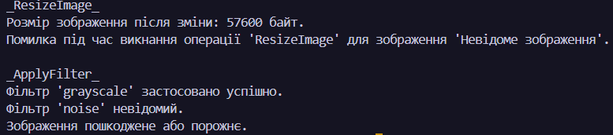

# Лабораторна робота №18

### **Тема:** Власні винятки та патерн Result.

### Варіант: 6. Сценарій: Обробка зображень.

- **Власний виняток:** ImageProcessingException (string ImageName, string Operation).
- **Service:** ImageProcessor.
- Метод byte[] ResizeImage(byte[] imageData, int width, int height):
  Викидає ImageProcessingException, якщо дані зображення пошкоджені.
- Метод Result&lt;bool> ApplyFilter(byte[] imageData, string filterName):
  Повертає Result.Success або Result.Failure (якщо фільтр невідомий).

# **Хід роботи:**

У ході роботи було створено власний виняток `ImageProcessingException` для повідомлення про помилки під час обробки зображень, клас `ImageProcessor` для зміни розміру та застосування фільтрів, а також узагальнений тип `Result<T>` для передачі результату операції як успіху або помилки. Метод `ResizeImage` перевіряє вхідні дані та викидає виняток, якщо зображення пошкоджене або параметри розміру некоректні. Метод `ApplyFilter` повертає успішний результат для підтримуваних фільтрів і повідомлення про помилку для невідомих фільтрів чи пошкоджених даних. Роботу програми продемонстровано на коректному зображенні, пошкоджених даних і різних назвах фільтрів.

# **Результат:**

### 
